# Raiden OS 1.0

A fast, beautiful desktop operating system in the spirit of Zorin OS, built on
**Ubuntu 26.04 LTS** with the **Linux 7.0** kernel, **GNOME 50**, the newest
graphics drivers for **NVIDIA and AMD**, and switchable Windows-, Windows 11-,
macOS- and GNOME-style layouts. Made for gaming, school and everyday use:
**Steam** and the other game launchers, **Outlook** and **Microsoft 365**,
**Google Chrome**, **Claude** and **Google Antigravity** are ready when you
are, and the system is tuned for games.

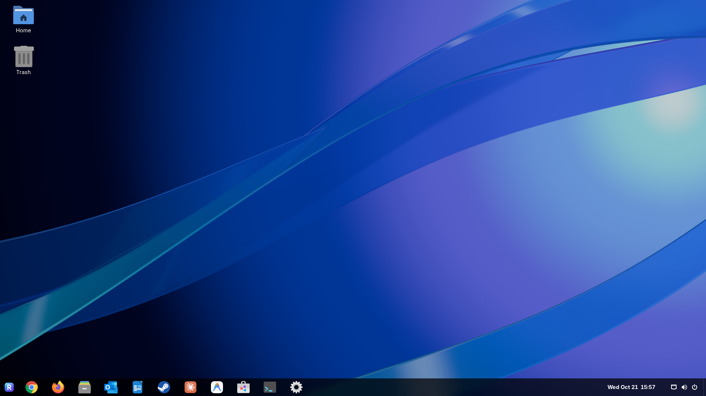

**Download:** [latest release](https://github.com/xrctz/raiden-os/releases/latest)
(the ISO comes in parts, see [Download](#download)).

---

## What's inside

| | |
|---|---|
| **Base** | Ubuntu 26.04 LTS "Resolute Raccoon": 5 years of security updates, the huge Ubuntu software archive |
| **Kernel** | Linux 7.0 on Ubuntu's *HWE* track: new kernels arrive automatically through normal updates. Signed for Secure Boot |
| **Desktop** | GNOME 50 on Wayland with a bottom taskbar + start menu by default (Dash to Panel + ArcMenu), frosted-glass effects (Blur my Shell), desktop icons, system tray |
| **Layouts** | *Appearance* app: Raiden (Windows 10-like), Modern (Windows 11-like, centered), Dock (macOS-like, with icon magnification), Classic (Ubuntu-like), GNOME |
| **Animations** | Taskbar icons ripple and the dock magnifies under the pointer, windows open and close with effects (Burn My Windows), wobble while you move them and minimise like a genie (Magic Lamp); all switchable in *Appearance → Effects* |
| **Displays** | Every monitor runs at its **highest refresh rate** (120, 144, 180 Hz…) automatically, the login screen too, instead of the 60 Hz most monitors ask for; wallpapers come in native **ultrawide** (3440×1440) versions |
| **NVIDIA** | NVIDIA 595 driver with open kernel modules, prebuilt and signed by Canonical (works with Secure Boot, no extra steps). Supports GTX 16xx and RTX 20/30/40/**50** series. Older **GTX 750 to GTX 10xx** cards get NVIDIA's legacy 580 driver from the ISO while installing (no internet needed). 32-bit driver libraries for Steam included |
| **AMD / Intel** | Mesa 26 with Vulkan, OpenGL and hardware video decoding (32-bit too, for Steam), latest `linux-firmware` and CPU microcode. Radeon HD 7000 and R7/R9 200 cards (GCN 1/2) are switched to the amdgpu driver, which gives them Vulkan |
| **Games** | **Steam**, **Heroic** (Epic, GOG, Amazon), **Lutris**, **ProtonPlus** (Proton-GE), MangoHud FPS overlay with GOverlay, Gamescope, GameMode (set up so it really can raise CPU speed and priority). Kernel tuning like SteamOS: Wine/Proton sync in the kernel (ntsync), the memory-map limit big games need, no split-lock slowdowns, larger shader caches against stutter |
| **School & work** | **Outlook** and **Microsoft 365** (Word, Excel, PowerPoint, OneDrive, Teams) as apps in their own windows, LibreOffice with Word-compatible fonts (Carlito, Caladea), Papers PDF viewer, **Xournal++** for handwritten notes and notes on PDFs, **Foliate** e-book reader; Zotero one click away in *Welcome* |
| **AI** | **Claude** desktop app (Claude Code and Cowork included) and **Google Antigravity** + **Antigravity IDE** desktop apps |
| **Browser** | **Google Chrome**, the default browser (Firefox until Chrome is installed, see [First start](#first-start)) |
| **Apps** | LibreOffice, Files, Terminal, Text Editor, Image Viewer, Document Viewer, Video Player, Rhythmbox, Calculator, Calendar, Weather, Clocks, Camera, Scanner, Disks, Resources, Timeshift snapshots, Déjà Dup backups, Extension Manager, firewall |
| **App store** | GNOME Software with **Flathub** (thousands of apps) and Ubuntu packages |
| **Battery** | Power modes (Performance / Balanced / Power Saver) in the quick settings, automatic power saver on low battery, battery-health charge limit on supported laptops, NVIDIA dynamic power management on hybrid laptops, battery percentage in the panel |
| **Smoothness** | zram compressed swap (tuned like Fedora/Pop!_OS), systemd-oomd, Wayland with fractional scaling and VRR support |
| **Updates** | Software Updater + automatic security updates. Chrome and Claude update automatically from Google's and Anthropic's repositories; Antigravity, ProtonPlus and Heroic are kept current by a daily check (while they are closed); Flatpak apps update in Software |
| **Extras** | Phone integration (GSConnect), codecs (MP3, H.264, HEVC…), printer and scanner drivers |
| **Privacy** | No telemetry, no crash-report uploads, no Snap |

### Screens

| Boot menu | Boot splash | Login |
|---|---|---|
| 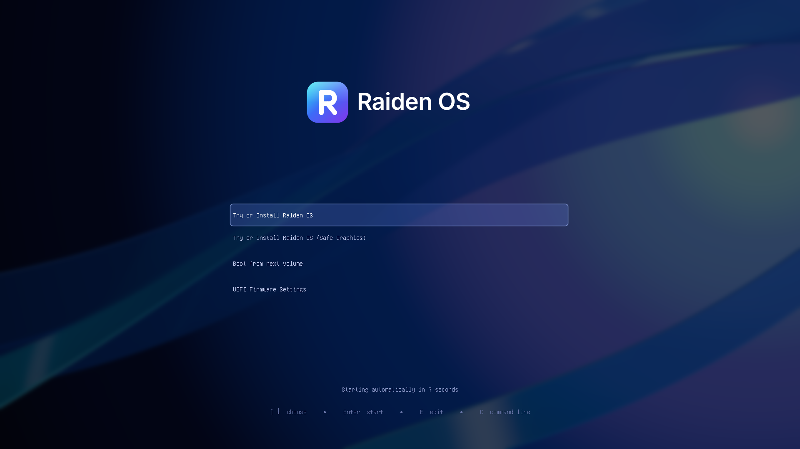 | 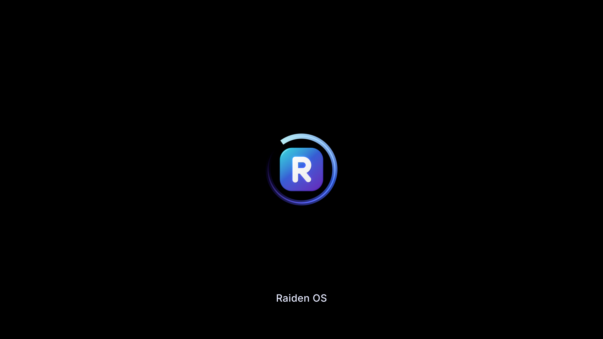 | 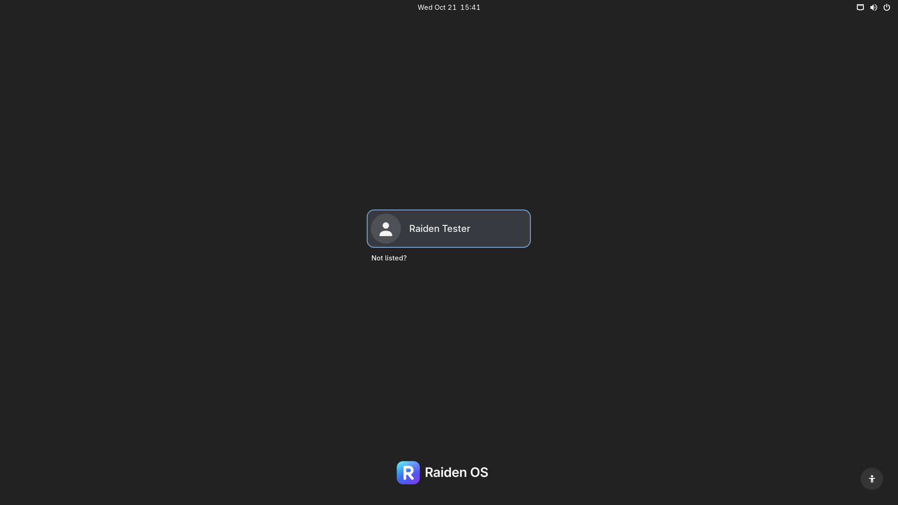 |

| Try or install | Installer | Installing |
|---|---|---|
| 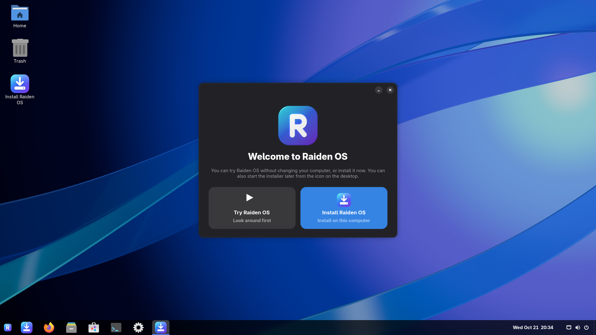 | 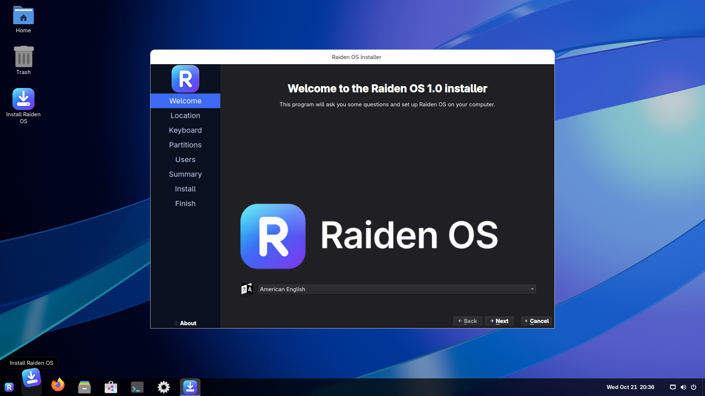 | 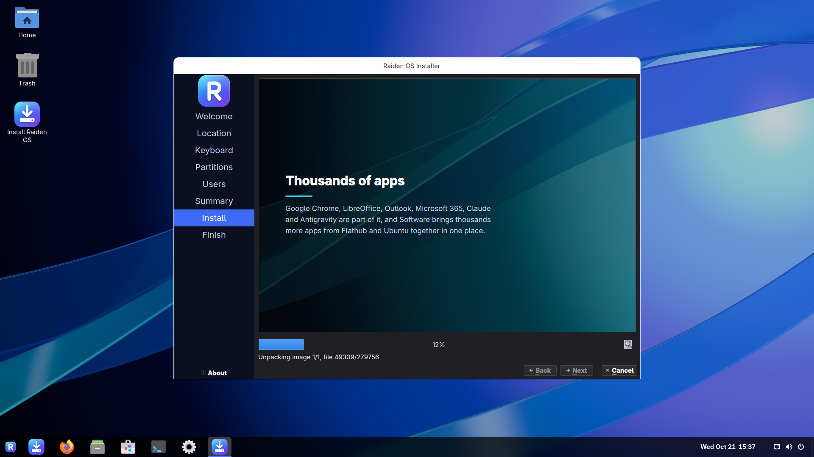 |

| Start menu | Appearance (layouts) | Welcome |
|---|---|---|
| 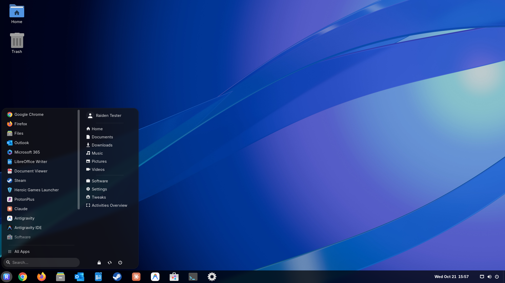 | 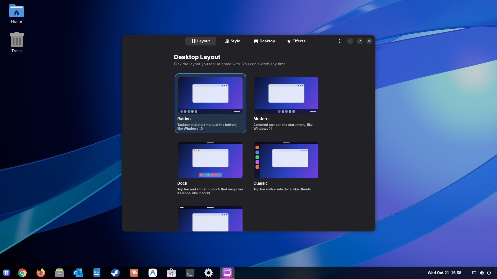 | 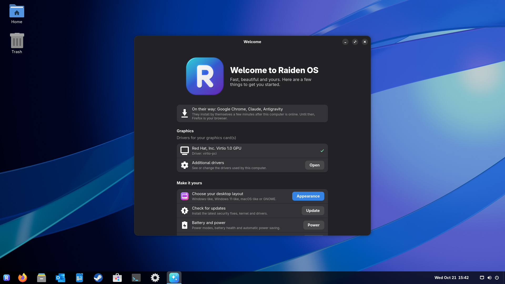 |

| Dock layout (macOS-like) | Modern layout (Windows 11-like) | Light mode |
|---|---|---|
| 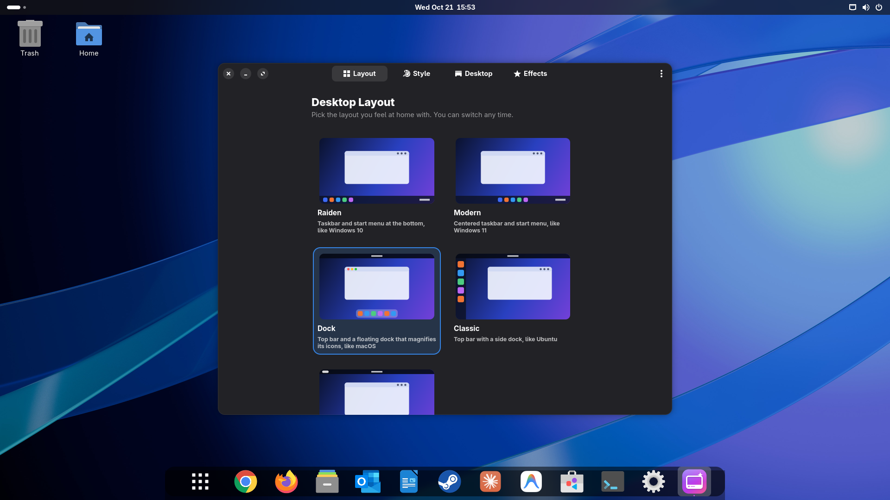 | 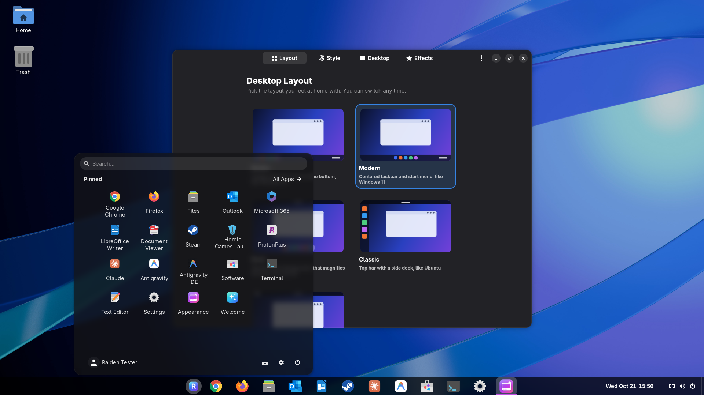 | 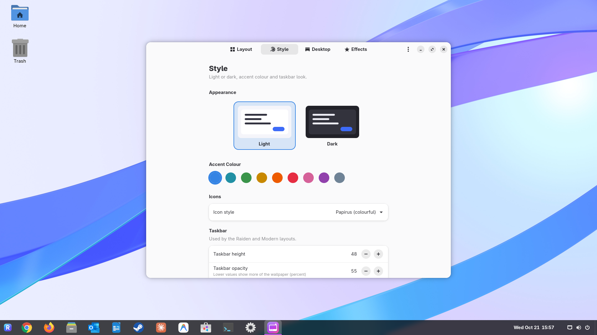 |

---

## Download

GitHub takes files of up to 2 GB, so the ISO is split into parts:

1. From the [latest release](https://github.com/xrctz/raiden-os/releases/latest)
   download every `raiden-os-1.0-amd64.iso.0…` part and `SHA256SUMS`, into one folder.
2. Join the parts into the ISO:
   * **Windows:** open the `.001` part with [7-Zip](https://www.7-zip.org/) and
     extract it, or in a terminal in that folder:
     `cmd /c copy /b raiden-os-1.0-amd64.iso.0* raiden-os-1.0-amd64.iso`
   * **Linux / macOS:** `cat raiden-os-1.0-amd64.iso.0* > raiden-os-1.0-amd64.iso`
3. Check it against `SHA256SUMS`: `sha256sum -c --ignore-missing SHA256SUMS` on
   Linux, or `Get-FileHash raiden-os-1.0-amd64.iso` in PowerShell (compare with
   the `raiden-os-1.0-amd64.iso` line).

## Install it on a computer

### 1. Write the ISO to a USB stick (8 GB or larger)

**Everything on the USB stick will be erased.**

* **Rufus** (Windows, recommended): pick the USB stick, click *SELECT* and
  choose `raiden-os-1.0-amd64.iso`, click *START*. When Rufus asks how to
  write the image, choose **"Write in DD Image mode"**.
* **balenaEtcher** (Windows/macOS/Linux): *Flash from file* → choose the ISO
  → choose the USB stick → *Flash*.
* **Ventoy** also works: copy the ISO onto a Ventoy stick.

### 2. Boot from the USB stick

1. Plug the stick in and restart the computer.
2. Open the one-time boot menu with the key for your computer while it starts:
   **F11** (MSI), **F8** (ASUS), **F12** (Gigabyte, Dell, Lenovo, Acer),
   **F9** (HP), **Option ⌥** (Intel Mac), or look for "Boot menu" on screen.
3. Pick the USB stick (choose the entry starting with **UEFI:** if there are two).

**Secure Boot can stay on.** Raiden OS uses the same Microsoft-signed boot
chain as Ubuntu, and the NVIDIA driver is signed too. (With Secure Boot on,
the boot menu text uses a plainer built-in font; that is a security
restriction of the boot loader, not a fault.)

In the boot menu:

* **Try or Install Raiden OS** — the normal choice.
* **Try or Install Raiden OS (Safe Graphics)** — if the screen stays black or
  garbled with the normal entry.

### 3. Try it, then install

The live desktop starts with a *Welcome* window: choose **Install Raiden OS**
(or try it first; the installer icon is on the desktop and in the taskbar).
The installer asks for language/time zone, keyboard, where to install, and
your user account. Installation takes about 5-10 minutes.

* **Erase disk** — uses the whole drive (you can tick *Encrypt system*).
* **Dual boot with Windows** — choose *Install alongside* (or shrink the Windows
  partition first in Windows *Disk Management* and use *Manual partitioning*).
  Before that, in Windows: turn off *Fast Startup*, and if BitLocker/Device
  Encryption is on, have the recovery key ready. A boot menu to pick Windows
  or Raiden OS appears automatically and remembers your last choice; the
  clock stays right in both systems (Raiden OS keeps it in local time like
  Windows does), and the app **Restart into Windows** starts Windows once.
  Installing to a separate drive (internal or USB) works the same way and
  leaves the Windows drive untouched.

### 4. First start

**Google Chrome, Claude, Antigravity and the Antigravity IDE install by
themselves** a few minutes after the computer is first online: their makers'
licences don't allow putting them on the ISO, so they come straight from
Google and Anthropic. Firefox is your browser until then, and Chrome becomes
the default once it is there. *Welcome* shows what is still on its way and
what is happening right now (*Try now* starts it at once); a notification
says when each app is ready. No restart is needed: if the computer is not
online yet, the apps install as soon as it is.

The **Welcome** app opens at the first login: pick a layout, check for
updates, see your graphics driver status, and find your games, school and AI
apps. **Appearance** (in the start menu) switches layouts, light/dark, accent
colour, wallpaper and effects at any time; **Appearance → Effects** picks the
icon animation (Off, Lift, Ripple, Magnify) and switches window effects,
wobbly windows, Magic Lamp, glass blur and the desktop cube on or off.

**Graphics drivers are automatic:**

* **NVIDIA RTX 50/40/30/20, GTX 16xx**: the NVIDIA 595 driver is preinstalled
  and active right away, also in the live session.
* **NVIDIA GTX 10xx, 9xx, 750 / 750 Ti, Titan V** (Pascal, Maxwell, Volta):
  the installer puts NVIDIA's legacy 580 driver on, straight from the USB
  stick. (The live session shows these cards with a basic display driver.)
* **NVIDIA GTX 600/700 (Kepler) and older**: NVIDIA no longer makes drivers
  for them; they run on the open-source nouveau driver.
* **AMD / Intel**: open-source Mesa drivers are built in, and the installer
  removes the unneeded NVIDIA driver. Radeon HD 7000 and R7/R9 200 series
  cards are switched from the old radeon driver to amdgpu, for Vulkan.

**Games:** the first time Steam starts it asks to install itself into your
home folder and downloads its latest version (2-3 GB). Windows games run
through Proton: in Steam, *Settings → Compatibility → Enable Steam Play for
all other titles* lets you try any of them. **ProtonPlus** adds Proton-GE
and other tools some games need (start Steam once first, so ProtonPlus finds
it). For a game that should run as fast as possible, set its *Launch
Options* (right-click → *Properties*) to `gamemoderun mangohud %command%`:
GameMode raises the CPU speed and the game's priority while it runs,
MangoHud shows FPS and temperatures (choose what in *GOverlay*). *Welcome*
copies that line for you.

**Chrome:** the first time it starts, Chrome asks you to accept Google's
terms, then offers to sign in; your Google account brings back bookmarks,
passwords and extensions.

**School and work:** *Outlook* and *Microsoft 365* open in their own windows
(Google Chrome app windows) and stay signed in after the first time; sign in
with your school account. Documents from Word open in LibreOffice with the
same fonts and layout. Xournal++ writes on PDFs (pen or keyboard).

**AI:** sign in to *Claude* with your Anthropic account and to *Antigravity*
with your Google account. Claude's Cowork tasks run in a small virtual
machine; the installer gives your account the permission for that (group
`kvm`).

**Updates:** *Software Updater* keeps the Ubuntu base, the Linux kernel (new
HWE kernels included), Mesa, the NVIDIA driver, Steam, Chrome and Claude up
to date, and security fixes install automatically in the background, Chrome
and Claude updates too. Antigravity, Antigravity IDE, ProtonPlus and Heroic
have no apt repository: a daily check installs their new releases while they
are closed (`systemctl status raiden-apps-update`). Apps from Flathub update
in *Software*.

---

## Build the ISO yourself

Requirements: Windows 10/11 with WSL 2, ~40 GB free disk space, internet.

```powershell
.\build.ps1 -Public
```

This creates (once) a WSL distro **RaidenOS-Build** (Ubuntu 26.04) and runs
`scripts/build.sh` inside it. The first build downloads about 5 GB and takes
30-60 minutes; the ISO appears in `out\public\`. Re-run a part of the build
with `-Redo desktop` (stages: `host bootstrap aptsetup base desktop configure
squashfs iso`) or start over with `-Clean`.

### Your own personal edition

Without `-Public`, `.\build.ps1` builds the *personal* edition: the same system,
but with Chrome, Claude and Antigravity copied onto the ISO, and your own
name and character themes if you like. Keep those in the `personal/` folder,
which git ignores, so nothing personal is ever published:

* **`personal/build.conf`** — your own settings, for example
  ```bash
  DISTRO_NAME="My Linux"
  ISO_FILENAME="my-linux-1.0-amd64.iso"
  DEFAULT_CHARACTER="hero"
  ```
* **`personal/characters/<id>/`** — a character theme: the picture as
  `art.png` (or `.jpg`/`.webp`) and its settings in `theme.json` (name,
  colours, style, face crop, window effects; the format is described in
  `artwork/make-characters.py`). It becomes the wallpaper, accent colour,
  login screen, profile picture and window effects, chosen in
  *Appearance → Characters*.

Character art is usually copyrighted, and apps like Chrome may not be passed
on: keep personal-edition ISOs to yourself.

### Customise

* **`build.conf`** — name, version, NVIDIA driver branches, kernel track, ISO name.
* **`config/packages/*.list`** — which apps and drivers are installed.
* **`packages/raiden-os-settings/…/90_raiden-os.gschema.override`** —
  default theme, layout, wallpaper, taskbar and power settings.
* **`artwork/`** — logo and icons (SVG), Blender scenes for the wallpapers and
  the boot animation (`artwork/blender/*.py`; `render_all_scenes.py` renders
  the 3D wallpapers and every ultrawide version headless with
  `blender -b --factory-startup --python …`), `make-assets.sh` generates the
  rest (GRUB theme, Plymouth theme, installer slides…).

### Update an installed system to a new build

Raiden OS's own parts (Appearance, Welcome, themes, default settings) come
from the ISO, not from an online repository. After a rebuild, the new packages
are in the build distro under `/var/tmp/raiden-build-public/debs/` (personal
edition: `/var/tmp/raiden-build/debs/`). Copy that whole folder to the
installed computer, connect it to the internet, open a terminal in the folder
and run:

```bash
sudo ./update-installed-system.sh
```

It turns on 32-bit support, adds Google's and Anthropic's repositories (for
Chrome and Claude) if they are missing, installs the packages (all but
`raiden-live`, which is only for the USB live session) and with them the new
apps, and adds the 32-bit graphics libraries. Missing apps then download in
the background.

### Test in a virtual machine

```bash
tests/qemu-run.sh start uefi --usb --fresh-disk   # Secure Boot on, Microsoft keys
tests/qemu-run.sh start bios --usb --fresh-disk   # legacy BIOS
python3 tests/qmp.py /var/tmp/raiden-test/qmp.sock shot screen.png
```

(run inside the build WSL distro; `tests/qmp.py` also clicks and types).

### How it is put together

```
build.conf                 identity: name, version, driver branches, edition
build.ps1                  Windows entry point (WSL)
scripts/build.sh           debootstrap -> packages -> configure -> squashfs -> ISO
scripts/build-packages.sh  builds the raiden-* .deb packages
scripts/make-iso.sh        hybrid BIOS/UEFI/Secure Boot ISO (Ubuntu's layout)
config/packages/           package lists (desktop, live session)
packages/                  raiden-os-settings       system defaults, os-release, GRUB, zram,
                                                    APT policy, session helpers (below)
                           raiden-os-artwork        wallpapers, icons, Plymouth + GRUB themes
                           raiden-appearance        Appearance app (layouts, style, characters,
                                                    effects)
                           raiden-welcome           Welcome app (first steps, drivers, apps)
                           raiden-gnome-extensions  Dash to Panel, ArcMenu, Blur my Shell, Burn
                                                    My Windows, wobbly windows, …
                           raiden-adw-gtk3-theme    GTK3 theme matching GNOME apps
                           raiden-apps              Chrome, Claude, Antigravity (+ IDE) and
                                                    ProtonPlus installed once, then kept
                                                    current (apps-update); Outlook and
                                                    Microsoft 365 web apps
                           raiden-gaming            game tuning: sysctl, ntsync, shader caches,
                                                    GameMode
                           raiden-live              live session + Calamares installer config
                           raiden-desktop           metapackage that keeps everything installed
patches/extensions/        our fixes for bugs in the vendored extensions (applied at build)
artwork/                   SVG sources, Blender scenes, renders, make-assets.sh
vendor/                    pinned third-party files (verified by SHA256SUMS)
tests/                     QEMU test VM and helpers
```

Session helpers (`/usr/libexec/raiden-os/`): **display-setup** runs every
monitor at its highest refresh rate the first time it is seen, swaps in
ultrawide wallpapers, and hands the display settings to the login screen
(through **login-screen-sync**, allowed by polkit for the person at the
computer); **theme-sync** keeps GTK3 themes, icons, desktop label colours and
the window effects in step with dark mode and the character theme;
**restart-into-windows** / **set-next-boot-windows** start Windows once on
dual-boot machines.

The installed system is a regular Ubuntu 26.04 LTS underneath (`ID=ubuntu` in
os-release), so Ubuntu tools, PPAs, `.deb` packages and documentation all work.

---

## Troubleshooting

* **Black screen when starting the USB stick** → choose *Safe Graphics* in the
  boot menu.
* **A 120/144/180 Hz monitor runs at 60 Hz** → Raiden OS picks the highest
  refresh rate the first time it sees a monitor (unless you already chose one
  in *Settings → Displays*, which it keeps).
* **Chrome, Claude or Antigravity did not appear** → they need internet; they
  install as soon as the computer is online, retrying by themselves for a few
  hours and again whenever it reconnects, no restart needed. *Welcome → Try
  now* starts it at once; `journalctl -u raiden-apps-update` shows what
  happened.
* **The clock is wrong by a few hours after switching between Windows and
  Linux** → run `sudo timedatectl set-local-rtc 1` once.
* **Flickering lines at the top of the screen, stutter, or stuck at 60 Hz on a
  Radeon RX 7600S/7700S laptop (e.g. ASUS TUF A16 Advantage)** → a Panel Self
  Refresh bug in AMD's display driver. The same bug can leave parts of the
  screen un-redrawn, e.g. *Show Apps* seems to do nothing or a newly pinned
  app appears only after a restart. The live USB and the installer turn it
  off automatically on these laptops (`amdgpu.dcdebugmask=0x10`).
* **Switching GPU modes (Eco / Standard / Ultimate) on ASUS laptops** → tools
  like G-Helper for Linux or supergfxctl work; a switch to or from Ultimate
  (MUX, the dGPU drives the screen) needs a reboot.
* **The USB stick is not in the boot menu** → disable *Fast Boot* in the
  firmware settings; make sure the stick was written in DD mode.
* **"Secure Boot violation" / "Verification failed" when starting the stick** →
  the PC doesn't trust Microsoft's third-party certificate that Ubuntu (and
  Raiden OS) is signed with. In the firmware settings enable *Allow
  Microsoft 3rd Party UEFI CA* (Lenovo, Surface and some others), or turn
  Secure Boot off.
* **Windows is missing from the boot menu after installing** → boot Raiden OS,
  open a terminal and run `sudo update-grub`.
* **Wi-Fi does not work** → connect with a cable once and run *Software
  Updater*; a few chips need extra drivers (*Welcome → Additional drivers*).
* Installer logs are kept in `/var/log/installer/` on the installed system.

## Credits

Built from Ubuntu and GNOME. Bundled third-party software keeps its licence:
Dash to Panel, ArcMenu, Blur my Shell, Caffeine, Desktop Cube, Magic Lamp
(GPL), adw-gtk3 (LGPL-2.1), Papirus icons (GPL-3), Inter font (OFL),
Plymouth dialog images (GPL-2+), Calamares (GPL-3), ProtonPlus and Heroic
(GPL-3), Firefox (MPL-2.0). Google Chrome, Google Antigravity, Claude and
Steam are their makers' own software: Raiden OS installs them as their makers
publish them, under their terms.
